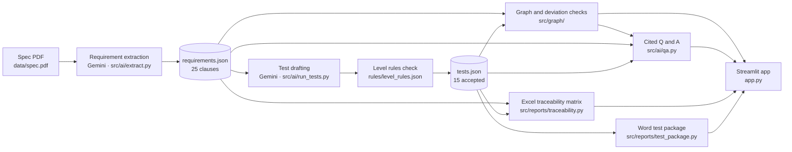

# Architecture: what we built (AI pipeline and reports)

**Reading the diagram**

- Gemini is used in two places: reading the spec into structured requirements, and drafting one test per clause in batches.
- The level rules are plain code, not AI. A test is rejected if its lower-level test is missing for the same equipment or system.
- Every answer in Q and A names the clause or test IDs it came from. If the model cites an ID that isn't in the context, the cite list drops it.
- Cached results let the demo run without the live API.
